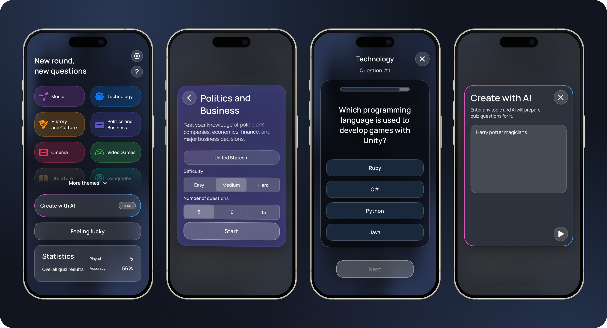

<p align="center">
  
</p>

# Quizice

A native iPhone quiz app for a quick round or a topic you want to explore.
Choose a theme, set the difficulty, answer against the clock, and track your
progress. Create a quiz from your own topic with AI, or let **Feeling lucky**
pick a mix of questions for you.

[Build from source](#build-from-source) · [How to play](#how-to-play) ·
[Development guide](docs/development.md) · [Report an issue](https://github.com/tabenskii/Quizice/issues)



*Home, round setup, gameplay, and AI creation in the Classic design. The preview
shows a connected backend catalog; the bundled catalog contains four themes.*

## Features

- **Short, configurable rounds.** Choose 5, 10, or 15 questions and an Easy,
  Medium, or Hard difficulty for backend and AI quizzes.
- **A growing catalog.** Explore topics from the backend, or start with bundled
  Music, Technology, History and Culture, and Politics and Business questions.
  Mark favorite themes to keep them at the top.
- **Create with AI.** Describe a topic and generate a quiz in the app's language.
  Production generation requires Game Center sign-in and backend access.
- **Track your progress.** See completed games, accuracy, and your best result.
  A backend session enables statistics sync and question-repeat preferences.
- **Make it yours.** Switch between Classic, Radar, and Clean designs, with
  system, light, and dark appearance options for Clean.
- **Play at your pace.** VoiceOver and Switch Control disable the question timer
  when active at the start of a round. The interface also supports Reduce Motion.

Available in **English, Russian, Spanish, German, Italian, and French**, with
an in-app language picker and a system-language option.

## How to play

1. Pick your favorite themes during onboarding, then open a theme card on Home.
2. Choose the round length and difficulty. Politics and Business also offers a
   country picker when the backend provides country-specific questions.
3. Answer each question from four choices. A standard round gives you 20 seconds
   per question, followed by feedback before you continue.
4. Review your result, play again, or return to Home to check your statistics.

For a mixed round, choose **Feeling lucky**. For a custom topic, open
**Create with AI**. Settings controls language, design, sound, and question-repeat
preferences.

## Build from source

There is no public App Store or TestFlight download yet. You can run Quizice
locally from this repository.

**Requirements:** a Mac with Xcode **26.2** (the version used in CI), and an
iPhone or Simulator running **iOS 18.0 or later**. Dependencies are managed by
Swift Package Manager; Xcode downloads them on first open.

```sh
git clone https://github.com/tabenskii/Quizice.git
cd Quizice
open Quizice.xcodeproj
```

1. Let Xcode resolve the packages and enable `SwiftLintBuildToolPlugin` if prompted.
2. Select the **Quizice** scheme and an iPhone Simulator.
3. Run with **⌘R** using the default **Debug** configuration.

A fresh Debug installation works with the bundled quiz catalog and analytics
disabled, without API keys or a backend configuration. To run on a physical
iPhone, select your development team in **Signing & Capabilities** and configure
signing for your account.

### Backend and AI setup

To connect services, copy the local configuration template and edit its values:

```sh
cp -n Configurations/Secrets.xcconfig.template Configurations/Secrets.xcconfig
```

| Setting | Debug | Release |
| --- | --- | --- |
| `BACKEND_BASE_URL` | Optional; a fresh install uses bundled questions when unset | Required HTTPS API URL ending in `/api` |
| `APPMETRICA_API_KEY` | Optional; empty disables analytics | Optional; empty disables analytics |

`Secrets.xcconfig` is excluded from Git. In an xcconfig file, write a URL as
`https:/$()/backend.example.com/api` so `//` is not treated as a comment.

Production AI generation runs through the backend using a session obtained via
Game Center. **Debug Simulator uses the direct AI service instead**, requiring
a local `YANDEX_AI_API_KEY` in the Run scheme. Bundled quizzes do not need it.

See the [development guide](docs/development.md) for configuration, analytics,
Release validation, and live backend tests, and
[Debug differences](docs/app-reference.md#отличия-debug) for the developer menu,
local backend, and direct AI setup.

## Architecture

Quizice uses **Swift, UIKit, SwiftUI, and SwiftData**. UIKit owns navigation and
the gameplay shell; SwiftUI provides selected content and settings surfaces.
Coordinators handle navigation, presenters drive gameplay, and reducers manage
Home card state.

| Directory | Responsibility |
| --- | --- |
| [`Quizice/App`](Quizice/App) | App lifecycle, dependency composition, navigation, and Debug tools |
| [`Quizice/Features`](Quizice/Features) | Home, quiz play and results, AI, onboarding, settings, and subscription UI |
| [`Quizice/Domain`](Quizice/Domain) | Models, quiz rules, and contracts independent of UI and networking frameworks |
| [`Quizice/Core`](Quizice/Core) | Persistence, authentication, networking, analytics, localization, and design system |
| [`QuiziceTests`](QuiziceTests) | Unit tests, UI contracts, and visual snapshots |

Dependencies flow from `App` to `Features`, then to `Domain` and `Core`.
SwiftData stores local data; Keychain stores the backend session.
See [Project structure](docs/project-structure.md) for ownership and conventions.

## Checks

Run the static checks without building the app:

```sh
./scripts/verify-s04-tests-and-failure-states.sh --checks-only
python3 scripts/tests/test-release-configuration.py
python3 scripts/tests/test-static-verifier.py
```

Run XCTest categories with the iOS **26.2** Simulator runtime installed:

```sh
./scripts/run-ios-test-category.sh unit "iPhone 17" 26.2
./scripts/run-ios-test-category.sh ui "iPhone SE (3rd generation)" 26.2
./scripts/run-ios-test-category.sh snapshots "iPhone 16e" 26.2
```

[GitHub Actions](.github/workflows/ios-tests.yml) runs these categories on pull
requests, adds UI checks on iPhone 17 Pro Max, combines coverage, and compiles
Release with a reserved example backend URL. Live backend tests are opt-in.
See [test configuration](docs/development.md#running-tests) for result bundles,
snapshot recording, and reruns.

## Current limitations

- **Offline play depends on the catalog.** Bundled questions work locally.
  Once a backend catalog is active, starting a round needs a successful network
  response; cached theme cards do not include playable questions.
- **Bundled questions do not filter by difficulty.** Difficulty selection applies
  to backend question requests and AI generation.
- **AI quizzes are temporary.** Generated questions belong to the current
  session and are not saved as permanent catalog themes. Replay generates a new quiz.
- **Quizice Plus is not available for purchase.** Purchase and restore flows
  are not connected. Profile, in-app feedback, and alternate app icons are also
  unfinished.

## Documentation

- [Development guide](docs/development.md) — service configuration, analytics,
  production builds, and tests.
- [How the app works](docs/app-reference.md) *(Russian)* — user flows, data sources,
  API contracts, storage, synchronization, and Debug behavior.
- [Project structure](docs/project-structure.md) — module ownership and dependencies.
- [Analytics taxonomy](docs/analytics-taxonomy.md) — events and payload rules.

Found a bug or have an idea? [Open an issue](https://github.com/tabenskii/Quizice/issues)
with the steps to reproduce, your iOS version, and screenshots when useful.
